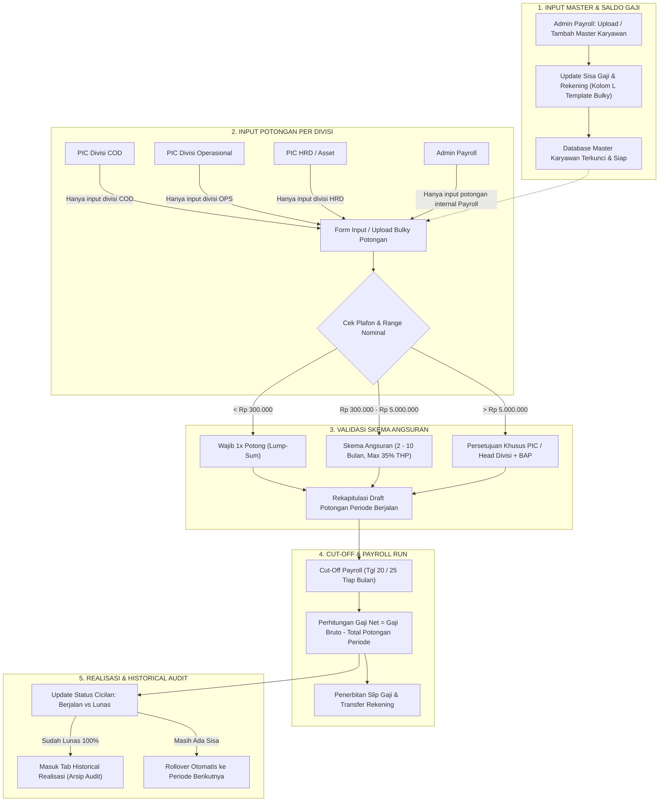

# Pedoman Alur Kebijakan, Matriks Otoritas, & Usulan Range Potongan
### Sistem Kontrol Potongan Gaji Kurir & Karyawan — SAP Express
*Materi Pembahasan & Panduan User Acceptance Testing (UAT)*

---

## 1. Latar Belakang & Tujuan
Sistem Kontrol Potongan Gaji SAP Express dikembangkan untuk:
1. **Transparansi & Akuntabilitas**: Memastikan seluruh potongan (COD, Operasional, Seragam, dll.) tercatat dengan bukti dukung yang valid.
2. **Pemisahan Wewenang (Segregation of Duties)**: Mengurangi risiko salah input atau overlapping data antar divisi.
3. **Perlindungan Kesejahteraan Karyawan/Kurir**: Memastikan potongan tidak melebihi kemampuan finansial bulanan kurir yang dapat mengganggu operasional pengiriman.
4. **Otomatisasi Tracking Angsuran**: Menghindari kekeliruan perhitungan sisa saldo angsuran multi-periode.

---

## 2. Flowchart Alur Operasional Sistem

Berikut adalah alur lengkap proses bisnis dan kontrol data dalam dashboard:



---

## 3. Matriks Otoritas & Hak Akses (RACI Matrix)

Untuk menjamin kepatuhan data, setiap menu dan tindakan dalam dashboard dibatasi secara ketat berdasarkan login role:

| Fitur / Tindakan | Admin Payroll | PIC Divisi Pengaju (COD, OPS, HRD) | Head of Division / Management | Kurir / Karyawan |
| :--- | :---: | :---: | :---: | :---: |
| **Tambah / Upload Master Karyawan** | **Accountable (A)** | *No Access* | *Informed (I)* | *No Access* |
| **Update Sisa Gaji Bulky (Kolom L)** | **Accountable (A)** | *No Access* | *Informed (I)* | *No Access* |
| **Input Potongan (Satuan / Excel)** | **Responsible (R)** *(Divisi Payroll saja)* | **Responsible (R)** *(Terkunci di divisinya)* | *Consulted (C)* | *No Access* |
| **Tentukan Skema Angsuran Standar** | *Consulted (C)* | **Responsible (R)** | *Informed (I)* | *Consulted (C)* |
| **Persetujuan Potongan > Rp 5.000.000** | *Informed (I)* | **Responsible (R)** | **Accountable (A)** | *Consulted (C)* |
| **Monitoring Dashboard & Analisis** | **Viewer (V)** | **Viewer (V)** *(Scope divisi)* | **Viewer (V)** *(All division)* | *No Access* |
| **Audit Historical Realisasi (Lunas)** | **Responsible (R)** | **Viewer (V)** | **Informed (I)** | *Informed (I)* |

> [!NOTE]
> - **PIC Divisi** tidak dapat memilih atau mengubah dropdown divisi ke divisi lain saat input manual maupun upload excel.
> - **Admin Payroll** memiliki privilege eksklusif untuk pengelolaan data karyawan dan sisa gaji di menu *Input Data*.

---

## 4. Usulan Kebijakan Range Nominal & Skema Angsuran (Draft Diskusi UAT)

Berikut adalah usulan parameter kebijakan potongan gaji yang dirancang untuk menjaga kelancaran cashflow perusahaan sekaligus stabilitas operasional kurir:

```
+----------------------------------------------------------------------------------------------------+
|                                    SPEKTRUM KEBIJAKAN RANGE POTONGAN                              |
+------------------------------------+------------------------------------+--------------------------+
|  Tier 1: < Rp 300.000              |  Tier 2: Rp 300.000 - Rp 5.000.000 |  Tier 3: > Rp 5.000.000  |
|  - Wajib 1x Potong (Lump-Sum)      |  - Skema Cicilan Bertingkat        |  - Special Case Approval |
|  - Tanpa opsi cicilan              |  - Tenor 2 - 10 Bulan              |  - Wajib BAP Investigasi |
|  - Efisiensi administrasi          |  - Safety Cap: Max 35% THP         |  - PIC / Head Divisi     |
+------------------------------------+------------------------------------+--------------------------+
```

### 1. Tier 1: Nominal Kecil (< Rp 300.000)
- **Ketentuan**: **Wajib 1x Potong (Lump-Sum)** pada periode cut-off gaji berjalan.
- **Rasional**:
  - Biaya administrasi & verifikasi pencatatan cicilan multi-bulan tidak sebanding dengan nominalnya.
  - Besaran nominal masih berada dalam batas toleransi pendapatan harian/mingguan kurir sehingga tidak mengganggu kebutuhan dasar.
- **Contoh Kasus**: Keterlambatan kiriman ringan, selisih kas kecil, atribut rusak kecil.

### 2. Tier 2: Nominal Menengah (Rp 300.000 s/d Rp 5.000.000)
- **Ketentuan**: **Dapat Dicicil** dengan tenor fleksibel berdasarkan simulasi berikut:

| Sub-Range Nominal | Usulan Tenor Maksimal | Estimasi Potongan / Bulan | Keterangan & Rekomendasi |
| :--- | :---: | :---: | :--- |
| **Rp 300.000 – Rp 1.500.000** | **2 – 3 Bulan** | Rp 150.000 – Rp 500.000 | Cocok untuk selisih COD standar atau retur bermasalah. |
| **Rp 1.500.001 – Rp 3.000.000** | **3 – 6 Bulan** | Rp 300.000 – Rp 600.000 | Tenor ideal agar kurir tidak terbebani secara psikologis. |
| **Rp 3.000.001 – Rp 5.000.000** | **6 – 10 Bulan** | Rp 350.000 – Rp 600.000 | Perlu persetujuan tertulis dari PIC Divisi & kurir ybs. |

> [!IMPORTANT]
> **Aturan Safety Cap (Plafon Perlindungan Take-Home Pay)**:
> Akumulasi seluruh cicilan potongan kurir dalam 1 bulan (termasuk jika ada potongan dari divisi berbeda) **tidak boleh melebihi 35% (atau max 40%) dari estimasi Take-Home Pay (THP)**. Jika melebihi cap, tenor otomatis diperpanjang sesuai sisa kapasitas cicilan.

### 3. Tier 3: Nominal Besar (> Rp 5.000.000)
- **Ketentuan**: **Keputusan Khusus PIC / Head of Division (Non-Standard Case)**.
- **Prosedur Wajib**:
  1. Penerbitan **Berita Acara Pemeriksaan (BAP)** investigasi kehilangan/kerusakan/fraud.
  2. Penandatanganan **Surat Pengakuan Hutang** bermaterai oleh karyawan/kurir.
  3. Alternatif opsi penyelesaian:
     - **Skema Khusus Tenor Panjang (> 12 Bulan)** dengan persetujuan Head of Division & HR Director.
     - **Skema Tanggung Renteng / Sharing Loss** (jika insiden melibatkan tim operasional/pos/hub).
     - **Pencairan Jaminan / Klaim Asuransi** (bila aset ekspedisi memiliki perlindungan asuransi).
     - **Jalur Hukum / Terminasi Hubungan Kerja** (jika ditemukan unsur kesengajaan kriminal/fraud).

---

## 5. Lembar Poin Diskusi untuk Sesi UAT (Discussion Checklist)

Saat presentasi dan sesi UAT berlangsung, gunakan poin-poin berikut untuk mencapai konsensus antar stakeholder:

1. **Batas Nominal Lump-Sum**: Apakah angka **Rp 300.000** sudah pas, atau perlu diturunkan ke Rp 200.000 / dinaikkan ke Rp 500.000?
2. **Safety Cap THP**: Berapa persentase maksimal potongan bulanan yang diizinkan (30%, 35%, atau 40%)?
3. **Mekanisme Resign Saat Masih Berhutang**: Jika kurir mengundurkan diri atau mangkir dengan sisa cicilan aktif, apakah dipotong langsung dari sisa gaji terakhir / ijazah jaminan / uang saku?
4. **Approval Level Tier 3**: Apakah persetujuan nominal > Rp 5.000.000 cukup sampai Head of Division, atau perlu persetujuan Finance/Payroll Manager?
5. **Jadwal Cut-Off Data**: Tanggal berapa PIC divisi wajib menyelesaikan submit data potongan setiap bulannya agar Admin Payroll sempat melakukan finalisasi gaji?

---

*File presentasi interaktif dapat diakses pada: `presentation_uat_payroll_system.html`*
